# Atividade – Boas práticas, acoplamento e coesão

Trabalho da G1 (React Native – Consumo de API): análise do projeto **fakestore-app**.
Branch desta entrega: `refatoracao-boas-praticas`.

## Integrantes do grupo

| Nome completo             | RA      |
|---------------------------|---------|
| Rafael Scortegagna Pedra  | 1136090 |
| Yuri Duarte Theisen       | 1125371 |
| Pedro Luis Alves Bartz    | 1135935 |

---

## Parte 1 – Boas práticas que já aplicamos (mesmo sem saber)

> Os trechos abaixo são do código original entregue na G1 (branch `main`); os números nas imagens são os números reais das linhas nos arquivos.

### 1. Separação de responsabilidades (camada de serviço)

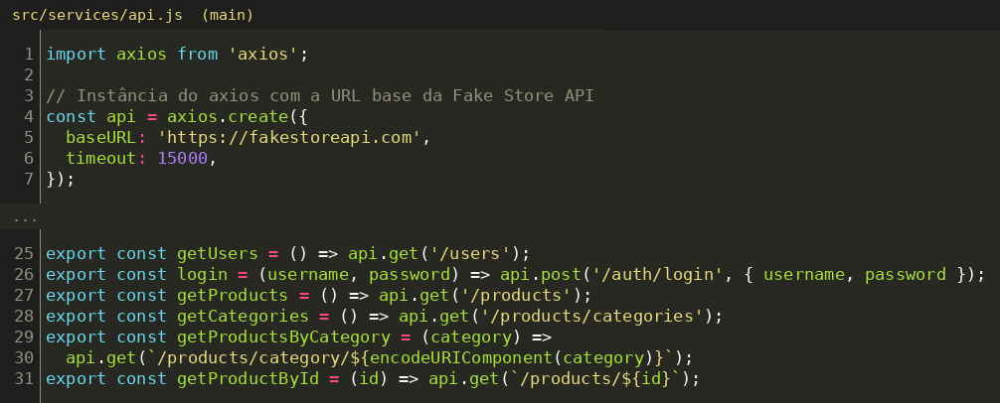

**Por que se encaixa:** todo o acesso HTTP está concentrado em `src/services/api.js`: a URL base e o timeout são definidos uma única vez e cada endpoint vira uma função com nome claro (`getProducts`, `login`...). As telas não montam URLs nem configuram o axios; se a API mudar de endereço, só um arquivo é alterado. É a prática de separar *interface* de *acesso a dados*.

### 2. Reuso de componentes / DRY (*Don't Repeat Yourself*)

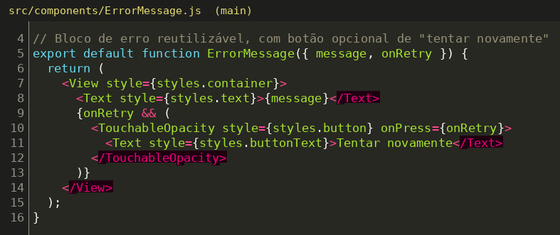
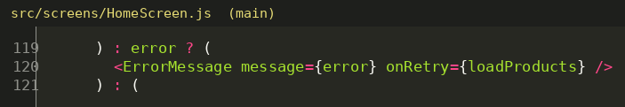
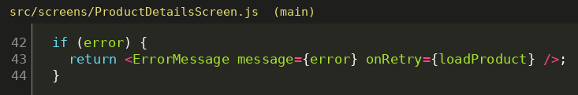

**Por que se encaixa:** o bloco visual de erro (mensagem + botão "Tentar novamente") foi escrito uma vez em `ErrorMessage` e reaproveitado em duas telas, só variando as *props* (`message`, `onRetry`). Evita copiar e colar JSX e estilos, e qualquer ajuste visual no erro vale para o app inteiro. O mesmo vale para o `HeaderButton`, usado nos dois lados do header.

### 3. Princípio da Responsabilidade Única (SRP) em funções utilitárias

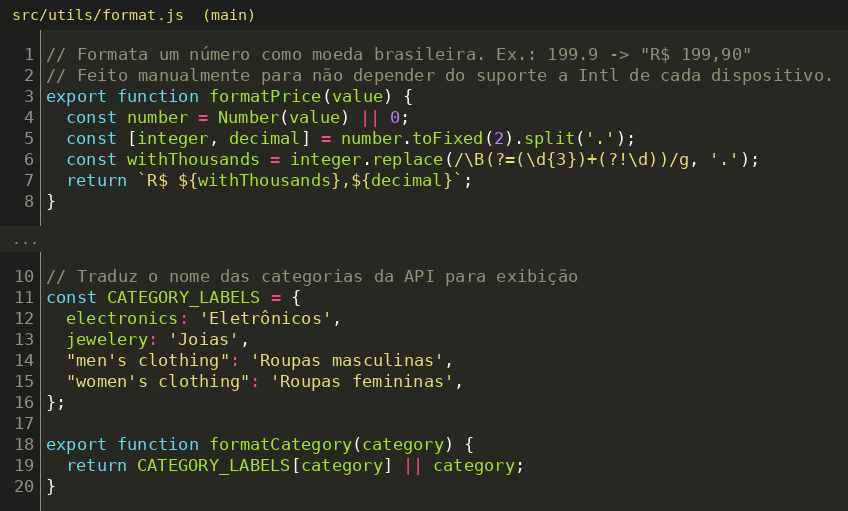

**Por que se encaixa:** `formatPrice` e `formatCategory` fazem uma coisa cada e são funções puras (mesma entrada, mesma saída, sem efeito colateral nem dependência de tela). Por isso são fáceis de testar e são reaproveitadas pela Home e pela tela de Detalhes, em vez de cada tela formatar preço do seu jeito.

### 4. Encapsulamento do tratamento de erros

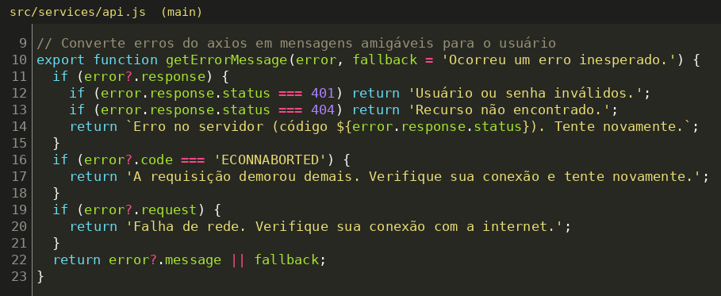

**Por que se encaixa:** a lógica de traduzir erros do axios (401, 404, timeout, falha de rede) em mensagens amigáveis está encapsulada em `getErrorMessage`. As telas só chamam a função e exibem o texto; não precisam conhecer `error.response`, `error.code` ou `error.request`. Detalhes internos ficam escondidos atrás de uma interface simples.

### 5. Fonte única de verdade (configuração e dados centralizados)

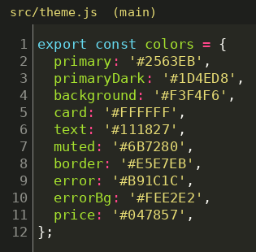
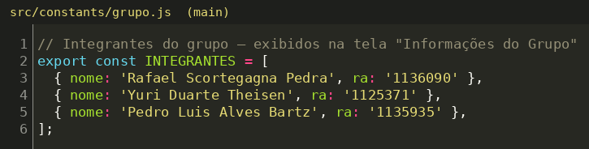
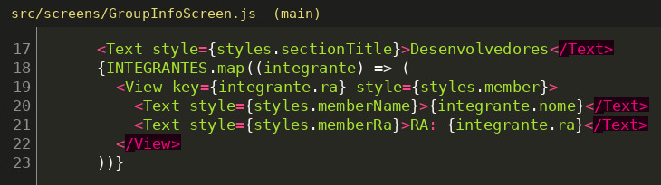

**Por que se encaixa:** as cores ficam em `theme.js` e os integrantes em `constants/grupo.js`, e as telas apenas consomem esses valores. Cada informação existe em um único lugar: trocar a cor primária ou incluir um integrante é uma edição de uma linha, sem caçar valores espalhados pelo código.

---

## Parte 2 – Boas práticas que melhoram o código (refatorações)

Dois problemas de acoplamento/coesão foram escolhidos e resolvidos. As mudanças estão no commit `refactor: extrai authService, useFetch e LoadingIndicator...` desta branch.

### Problema 1 – `LoginScreen` com baixa coesão e alto acoplamento à API

**Diagnóstico.** A função `handleLogin` fazia três trabalhos diferentes: (1) validar o formulário, (2) executar a **regra de autenticação** (buscar usuários, comparar senha, chamar o login, checar o token) e (3) controlar a navegação/estado da tela. Além disso, a tela desestruturava `{ data }` direto da resposta do axios, ou seja, conhecia o formato de resposta da biblioteca HTTP.

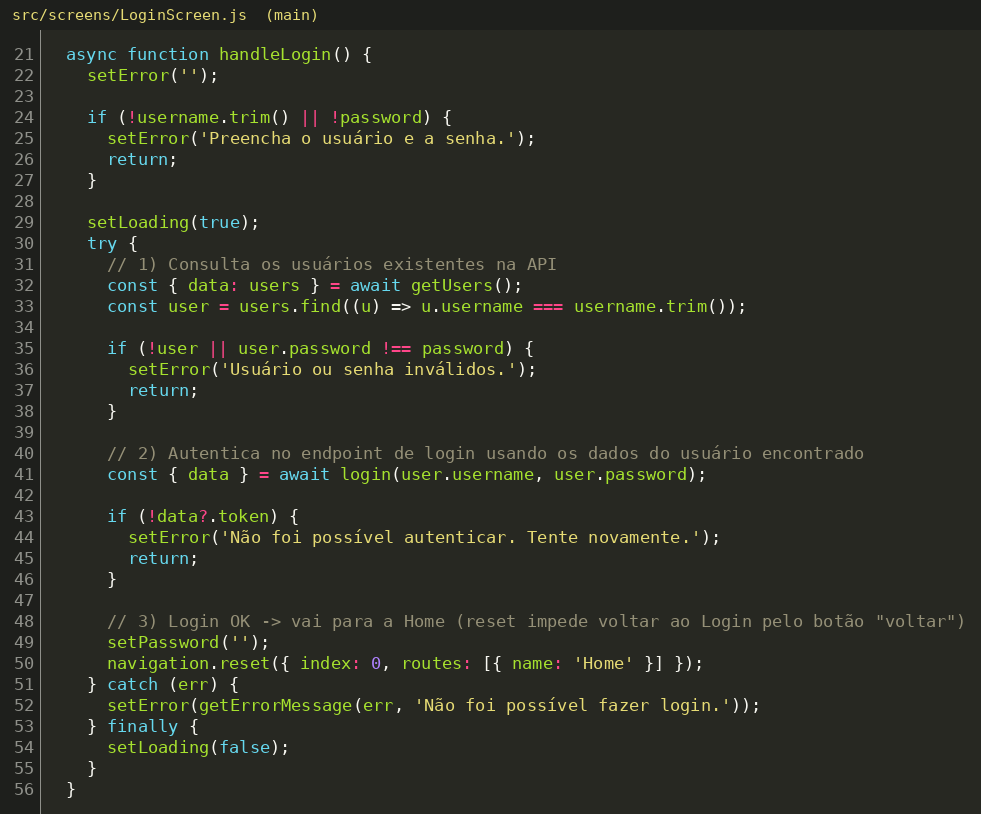

**Justificativa da escolha.** É o caso mais claro de **baixa coesão**: regra de negócio misturada com interface. Também é o mais crítico: autenticação é a regra mais sensível do app, e do jeito que estava só podia ser testada renderizando a tela. Trocar o axios ou o fluxo de login obrigaria a mexer em código de UI.

**Solução.**
- Nova camada `src/services/authService.js` com `authenticate(username, password)`, que concentra a regra e lança `AuthError` com mensagem amigável quando falha.
- `api.js` passou a devolver apenas o corpo da resposta (`response.data`), então nenhuma tela ou serviço depende mais do formato do axios.
- A `LoginScreen` agora só valida o formulário, chama `authenticate` e reage ao resultado (navegar ou mostrar erro).

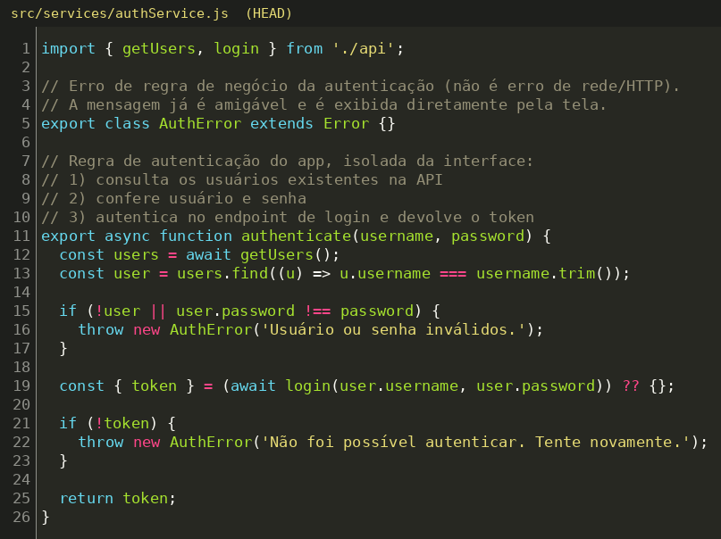
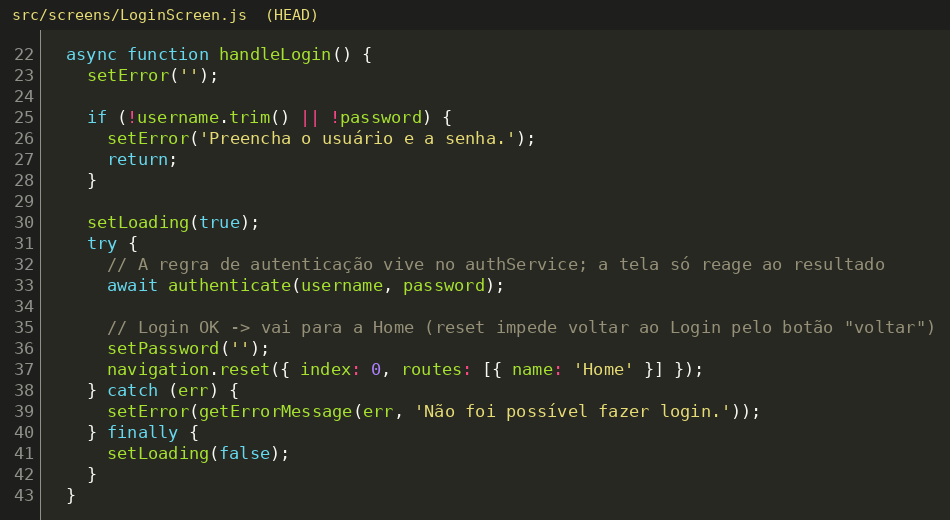
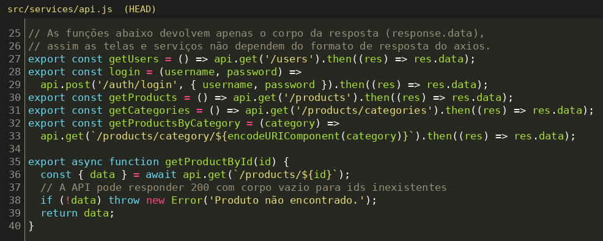

**Conceitos aplicados:** alta coesão (cada módulo com um propósito), baixo acoplamento (a tela depende de uma função `authenticate`, não do axios nem do formato da resposta), Responsabilidade Única e separação de camadas (UI → serviço → API).

### Problema 2 – Duplicação do ciclo carregando/erro/sucesso em `HomeScreen` e `ProductDetailsScreen`

**Diagnóstico.** As duas telas repetiam o mesmo código: três `useState` (`data`, `loading`, `error`), um `useCallback` com `try/catch/finally`, um `useEffect` para disparar a carga e o mesmo bloco visual de "Carregando..." (com `ActivityIndicator` e estilos copiados). A `HomeScreen` ainda acumulava a responsabilidade de gerenciar esse ciclo junto com o filtro e a renderização da lista.

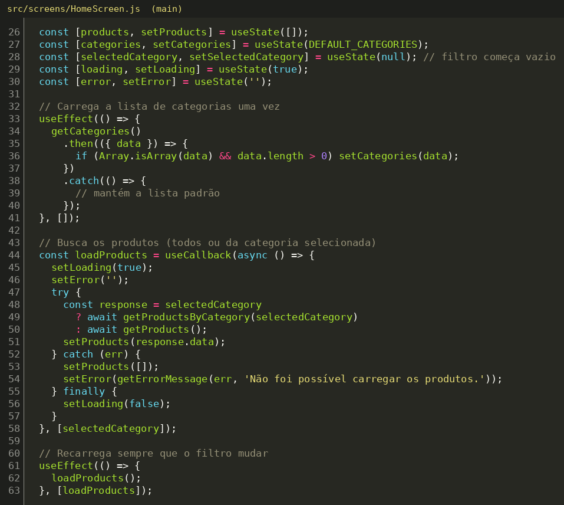
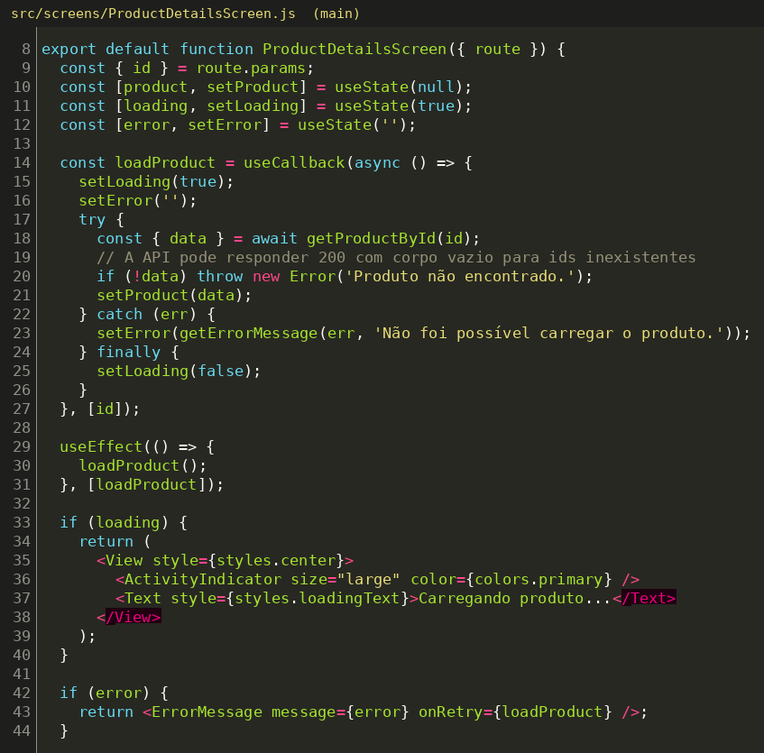

**Justificativa da escolha.** É a maior duplicação do projeto (~25 linhas de lógica + estilos repetidos em cada tela) e tende a piorar: cada nova tela que consome a API copiaria o mesmo bloco, e uma correção (por exemplo, tratar o erro de outra forma) precisaria ser replicada em todas. Isso é baixa coesão (a tela cuida de "como buscar dados") e acoplamento por duplicação.

**Solução.**
- Hook customizado `src/hooks/useFetch.js`: recebe a função de requisição e devolve `{ data, loading, error, reload }`, refazendo a carga automaticamente quando a requisição muda (ex.: troca de categoria).
- Componente `src/components/LoadingIndicator.js` com o indicador de carregamento e seus estilos.
- A validação "produto não encontrado" (resposta vazia da API) foi para `getProductById` em `api.js`, onde pertence.
- As duas telas passaram a só declarar *o que* buscar e *como exibir*.

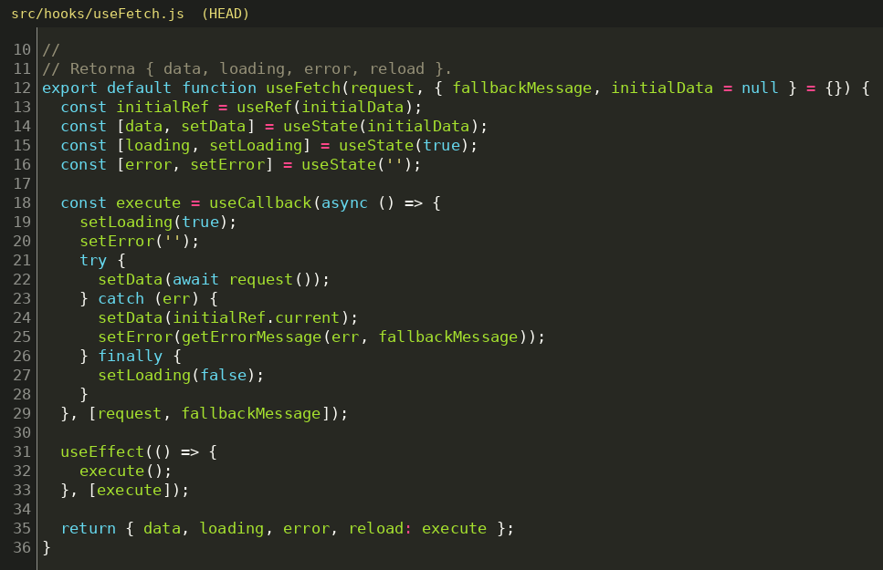
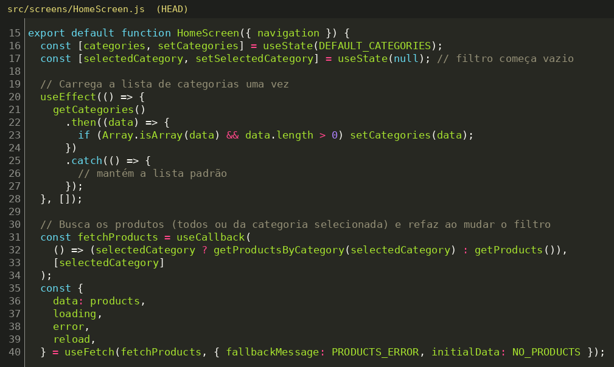
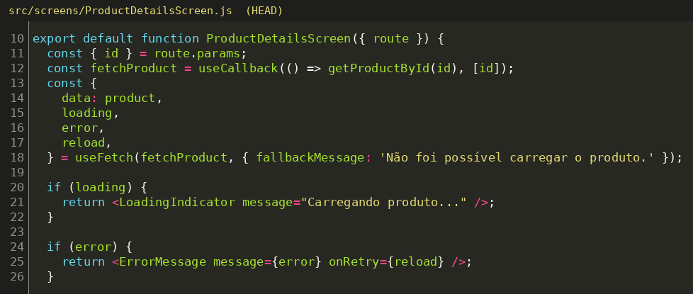
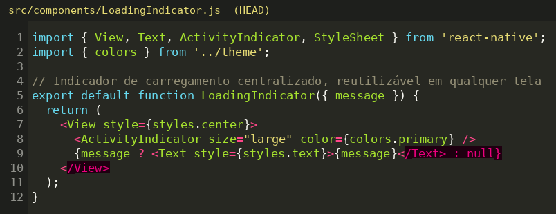

**Conceitos aplicados:** DRY, alta coesão (o hook cuida só do ciclo da requisição, as telas só da apresentação), baixo acoplamento (as telas não conhecem o tratamento de erro nem o controle de estado de carregamento) e reuso (nova tela com API = uma chamada a `useFetch`).

### Resultado

| | Antes | Depois |
|---|---|---|
| `LoginScreen.handleLogin` | 36 linhas com regra de negócio | 22 linhas, só UI e navegação |
| Estado de carregamento (Home + Detalhes) | duplicado nas 2 telas | 1 hook + 1 componente |
| Telas conhecem o formato do axios (`.data`) | sim | não (apenas `api.js`) |
| Comportamento do app | — | idêntico (mesmas mensagens, mesmo fluxo) |

Verificação feita: o app compila (bundle de `App.js` sem erros) e foram executados testes automatizados descartáveis cobrindo `authService` (sucesso, senha errada, usuário inexistente, token ausente, 401 e 500), `api.js` (produto vazio) e `useFetch` (sucesso, erro, mensagem de fallback e `reload`).
